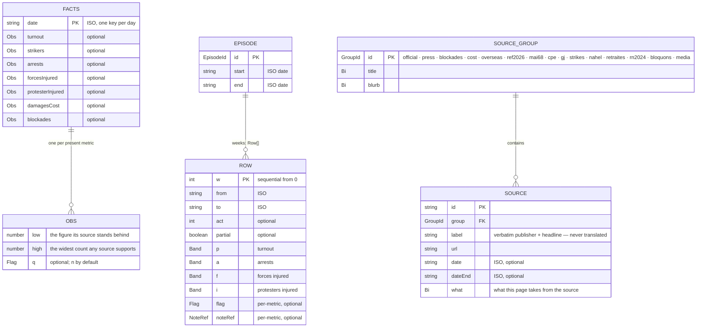
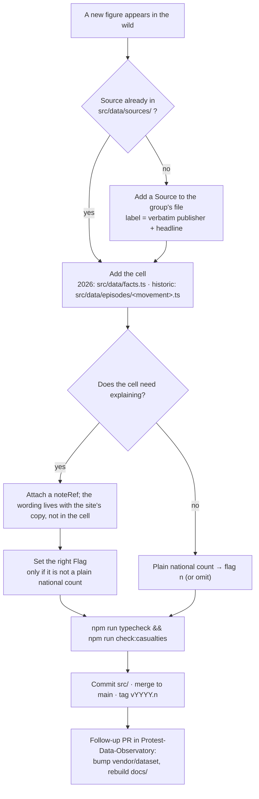

# Dataset — the 2026 Autumn protests in France

> _Le dataset de référence des manifestations de l'automne 2026 : mobilisations,
> réponse de l'appareil d'État, mouvements de comparaison._

The core dataset for the 2026 Autumn protests in France (student protests /
Gilets Jaunes × Gen Z). Every figure carries its source, quoted verbatim —
nothing here is averaged, imputed, or "approximately." The
[Protest Data Observatory](https://manifestigations.github.io/Protest-Data-Observatory/)
draws its charts from this data; **this repository is the source of truth**,
the site only displays it.

Everything is TypeScript you can read on GitHub. There is no build step to run
and no package to install in order to _read_ the data — the values are literals
in the files below.

## Read the data without installing anything

| You want                                                                                                                           | Look in                                                                                                                                                                                                                                                                                                                                                                                           |
| ---------------------------------------------------------------------------------------------------------------------------------- | ------------------------------------------------------------------------------------------------------------------------------------------------------------------------------------------------------------------------------------------------------------------------------------------------------------------------------------------------------------------------------------------------- |
| The 2026 figures, day by day (turnout, strikers, arrests, injuries, blockaded schools, damages, cost of policing)                  | [`src/data/facts.ts`](https://github.com/Manifestigations/Dataset/blob/main/src/data/facts.ts) — `FACTS`, one key per ISO date, each cell `{ low, high, q? }`                                                                                                                                                                                                                                     |
| The derived daily and weekly series, the window and the school-holiday band                                                        | [`src/data/projections.ts`](https://github.com/Manifestigations/Dataset/blob/main/src/data/projections.ts) (daily), [`src/data/aggregate.ts`](https://github.com/Manifestigations/Dataset/blob/main/src/data/aggregate.ts) (weekly), [`src/data/calendar.ts`](https://github.com/Manifestigations/Dataset/blob/main/src/data/calendar.ts) (`START`/`END`, `WEEKS`, `HOLIDAY_START`/`HOLIDAY_END`) |
| Deployments, force levels, the cost rate, helicopter hours                                                                         | [`src/data/policing.ts`](https://github.com/Manifestigations/Dataset/blob/main/src/data/policing.ts), [`src/data/helicopters.ts`](https://github.com/Manifestigations/Dataset/blob/main/src/data/helicopters.ts)                                                                                                                                                                                  |
| Denominators (populations)                                                                                                         | [`src/data/population.ts`](https://github.com/Manifestigations/Dataset/blob/main/src/data/population.ts)                                                                                                                                                                                                                                                                                          |
| Who protests, who polices: age, sex, nationality and the **absence** of ethnic statistics                                          | [`src/data/demographics/`](https://github.com/Manifestigations/Dataset/tree/main/src/data/demographics) — `DemoRow` per source and population, `DemoGap` for what does not exist, `DemoProxy` for what is not ethnicity                                                                                                                                                                           |
| Past movements for comparison (Mai 68, CPE, Gilets Jaunes, Nahel, pensions 2023, « Bloquons tout », students 2026 — one file each) | [`src/data/episodes/`](https://github.com/Manifestigations/Dataset/tree/main/src/data/episodes)                                                                                                                                                                                                                                                                                                   |
| The catalogue of every source (who published what, on which date)                                                                  | [`src/data/sources/`](https://github.com/Manifestigations/Dataset/tree/main/src/data/sources) — one file per group                                                                                                                                                                                                                                                                                |
| The casualty data, its severities, observations and estimators                                                                     | [`src/data/casualties/`](https://github.com/Manifestigations/Dataset/tree/main/src/data/casualties)                                                                                                                                                                                                                                                                                               |
| Disruptive acts by day and by category (official count → widest count)                                                             | [`src/data/disruptive/`](https://github.com/Manifestigations/Dataset/tree/main/src/data/disruptive) — `ACT_ROWS`, one row per (date, category), each with a `unit`                                                                                                                                                                                                                                |
| The types everything is written against                                                                                            | [`src/model/index.ts`](https://github.com/Manifestigations/Dataset/blob/main/src/model/index.ts)                                                                                                                                                                                                                                                                                                  |
| Why a figure was chosen, and what was rejected                                                                                     | [`src/data/data.ts`](https://github.com/Manifestigations/Dataset/blob/main/src/data/data.ts) — the verification record, then the barrel                                                                                                                                                                                                                                                           |
| Known data problems, and how each was settled                                                                                      | [`content/data-problems.md`](https://github.com/Manifestigations/Protest-Data-Observatory/blob/main/content/data-problems.md) — kept in the Observatory repo, because it is prose about method                                                                                                                                                                                                    |

Every path above goes through [`src/data/data.ts`](https://github.com/Manifestigations/Dataset/blob/main/src/data/data.ts)
as its public entry point for the 2026 layer: that file only re-exports, so
importing from it keeps import paths stable while the modules underneath move.

## How a figure is stored

Three shapes, one per data kind. All live in TypeScript and are checked by
`npm run typecheck`.

**2026 daily cells** — `FACTS` is a record keyed by ISO date; each present
metric is an `Obs`, and a point figure has `low === high`:

```ts
// src/data/facts.ts
export const FACTS: Readonly<Record<string, Partial<Record<MetricKey, Obs>>>> =
  {
    "2026-09-28": {
      arrests: { low: 164, high: 164 },
      protesterInjured: { low: 1, high: 1, q: "f" },
      blockades: { low: 27, high: 27 },
    },
  };
```

`Obs` is `{ low, high, q? }` (`src/data/types.ts`). The daily and weekly series
(`Pt` = `{ v, band, q, note, detach }`, `Series = Pt[]`) are **computed** from
`FACTS` in `projections.ts` and `aggregate.ts` — never hand-edited.

**Historical weeks** — a `Row` is one week of an `Episode`:

```ts
// src/data/episodes/nahel.ts
{ w: 0, from: "2023-06-26", to: "2023-07-02", p: [8_000, 50_000], flag: { p: "e" } },
{ w: 1, from: "2023-07-03", to: "2023-07-09", a: 108, f: 1 },
```

**Demographic shares** — a `DemoRow` is one source's composition of one named
population. A share never travels without its base, and an absent figure is a
`DemoGap` with a cause, never a zero:

```ts
// src/data/demographics/protesters.ts
{
  id: "dpjj-lycee-2026-sex",
  side: "protesters",
  source: "dpjj-etude-flash-lycee-2026",
  period: { from: "2026-09-18", to: "2026-10-09" },
  population: { en: "Minors referred to a prosecutor…", fr: "Mineurs déférés…" },
  shares: [{ dim: "sex", bucket: "filles", value: 7, n: [101, 1504], base: "all" }],
  basis: "document",
}
```

Rows are **not** summable and **not** a time series: they are different
populations on different dates. `base` says what the percentage is a percentage
of; `poll` means support, not participation.

`Row` (`src/model/index.ts`): `w` runs sequentially from 0, `from`/`to` are ISO,
`p` turnout · `a` arrests · `f` forces injured · `i` protesters injured, each a
`Band` = `number | [low, high]`, with optional per-metric `flag` and `noteRef`.
A missing metric means "no published figure" — never zero.

## Flags

| Flag | Meaning                                                                 | Detached |
| ---- | ----------------------------------------------------------------------- | -------- |
| `n`  | published national point figure (the default; may be omitted)           | no       |
| `r`  | regional only — one city, one prefecture                                | **yes**  |
| `p`  | partial coverage                                                        | **yes**  |
| `f`  | floor: "at least N"                                                     | no       |
| `e`  | derived or modelled — the arithmetic is stated                          | **yes**  |
| `c`  | cumulative stock, or a subset of a larger published total               | **yes**  |
| `w`  | weekly aggregate                                                        | no       |
| `x`  | a wider measure than the metric's strict definition (perturbés, closed) | no       |

`isDetached(q)` in `src/model/index.ts` is the single definition of "must not be
joined to the national line": `r`, `p`, `e`, `c`. `bandOf()` flattens a band to
`[low, high]`; `midOf()` is the plotting midpoint only — a drawing convention,
never an estimate, never to be averaged.

### Disruptive acts: two units, never one total

A day's `disruptiveActs` is the ministry's count of _actions de voie publique_ —
an act count. A `schoolBlockade` row is a count of _establishments_ where pupils
could not be received. Premises hit are _premises_; clashes are _incidents_.
`assertSingleUnit()` throws if a caller tries to add across them, and
`dayActionCategories()` returns a category sum flagged `c`, because the
categories are a subset of the day's total and must never be added to it.

The average of `low` and `high` is nowhere in this repository. It is `midOf()`
at render time, and it is a drawing convention.

## Invariants (do not violate)

- A published range stays a range. Never average two publishers; never
  midpoint a band.
- Never change a flag to make a series continuous (`r`, `p`, `e`, `c` are
  detached by definition).
- Never interpolate a gap. Absent cell = no published figure.
- Never add a `c` cell to the total it is a subset of.
- A source's `label` is the publisher + headline **verbatim**, never
  translated.
- Human-facing strings exist in both `en` and `fr`; the French is authored,
  not translated.



## Contributing

- **Report a figure** (no code, no install — a GitHub account is enough): open
  an issue here, using the
  [report-a-figure form](https://github.com/Manifestigations/Dataset/issues/new?template=report-a-figure.yml).
  See [CONTRIBUTING, §1](CONTRIBUTING.md#1-reporting-a-figure-no-code-no-install).
- **Edit the data** (Node ≥ 22.18; you are editing literal values in TypeScript
  files): [CONTRIBUTING, §2](CONTRIBUTING.md#2-editing-data).

## How one number gets in



> The loop you must **not** do: averaging two publishers, mid-pointing a band,
> interpolating a gap, re-flagging a point to make a series continuous, or
> adding a `c` cell to the total it is a subset of.

## What this repository does and does not do

- `json/` and `schema/` exist and are maintained; `scripts/build.ts` writes the
  bundle, `scripts/validate.ts` checks it against the schemas.
- `package.json` is `"name": "@manifestigations/dataset"`, `"private": true`.
- CI runs `.github/workflows/style.yml`; `npm run check:casualties` is the one
  data-integrity check, and it covers casualties only.
