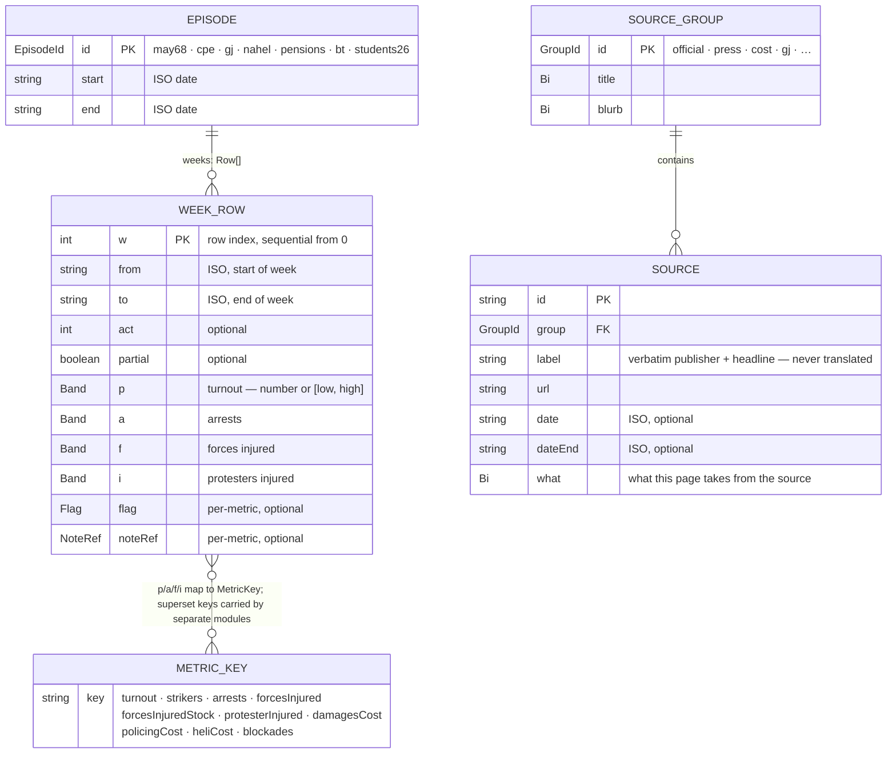
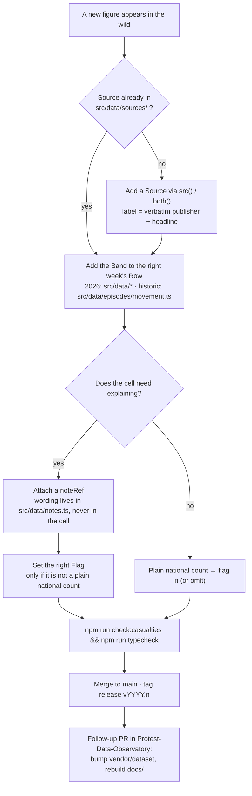

# Dataset

The core dataset and data models for the 2026 Autumn protests in France
(student protests / Gilets Jaunes × Gen Z). Consumed by
[Protest-Data-Observatory](https://github.com/Manifestigations/Protest-Data-Observatory)
as a git submodule and bundled into its site build.

## Layout

- `src/data/` — 2026 figures, historical episodes, source catalogues, casualty data
- `src/model/index.ts` — shared types (`Metric`, `Flag`, `Band`, `Row`, `Episode`, …)
- `scripts/check-casualties.ts` — data-integrity checks

## Invariants (do not violate)

- `Band = number | [number, number]` — a published range stays a range.
  Never average two publishers; never midpoint a band.
- Never change a `Flag` to make a series continuous (`r|p|e|c` are detached by definition).
- Never interpolate a gap. Absent cell = no published figure.
- `Source.label` is verbatim publisher + headline, never translated.
- All user-visible strings are `Bi = { en, fr }`. French is authored, not translated.
- Not verified data: never present figures as fact in copy or docs.

## Contributing

1. Branch, edit the data, add/keep a verbatim-labelled `Source` for every figure.
2. `npm install && npm run check:casualties && npm run typecheck`
3. Merge to `main`, tag a release (`vYYYY.n`).
4. Open a follow-up PR in Protest-Data-Observatory bumping `vendor/dataset`
   and rebuilding `docs/`.

## How one number gets in

> The loop you must **not** do: averaging two publishers, mid-pointing a band, interpolating a gap, or
> re-flagging a point to make a series continuous.
