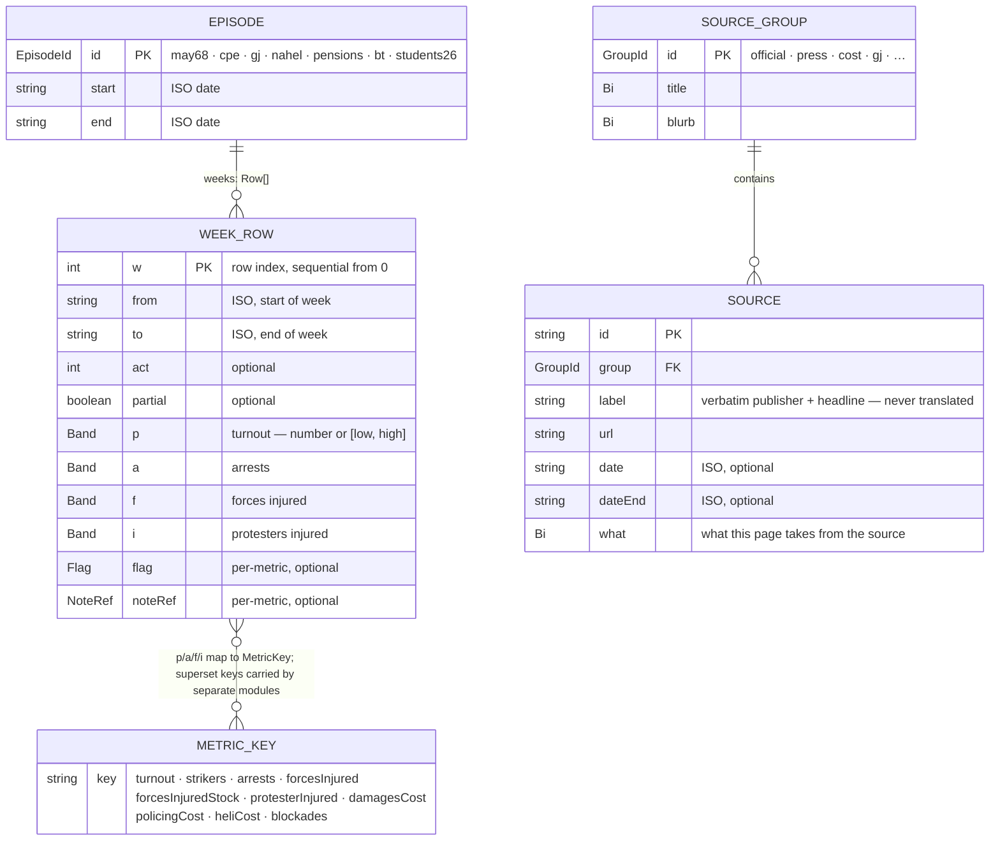
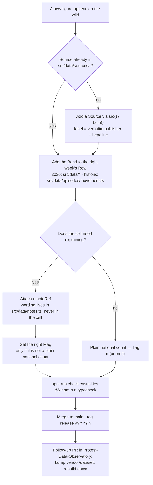

# Dataset — the 2026 Autumn protests in France

> *Le dataset de référence des manifestations de l'automne 2026 : mobilisations,
> réponse de l'appareil d'État, mouvements de comparaison.*

The core dataset for the 2026 Autumn protests in France (student protests /
Gilets Jaunes × Gen Z). Every figure carries its source, quoted verbatim —
nothing here is averaged, imputed, or "approximately." The
[Protest Data Observatory](https://manifestigations.github.io/Protest-Data-Observatory/)
draws its charts from this data; **this repository is the source of truth**,
the site only displays it.

## Read the data without installing anything

Everything is a human-readable file on GitHub:

| You want | Look in |
| --- | --- |
| The 2026 figures, day by day (turnout, strikers, arrests, injuries, blockaded schools, damages, cost of policing) | [`src/reference/data.ts`](https://github.com/Manifestigations/Dataset/blob/main/src/reference/data.ts) — raw observations in `FACTS`, one key per ISO date |
| Past movements for comparison (Mai 68, CPE, Gilets Jaunes, Nahel, the 2023 reform strikes, bloquons, students 2026 — one file each) | [`src/episodes/`](https://github.com/Manifestigations/Dataset/tree/main/src/episodes) |
| The catalogue of every source (who published what, on which date) | [`src/sources/`](https://github.com/Manifestigations/Dataset/tree/main/src/sources) |
| Explanations attached to specific cells | [`src/reference/notes.ts`](https://github.com/Manifestigations/Dataset/blob/main/src/reference/notes.ts) |
| Denominators (populations) | [`src/reference/population.ts`](https://github.com/Manifestigations/Dataset/blob/main/src/reference/population.ts) |
| Known data problems, and how each was settled | [`docs/data-problems.md`](https://github.com/Manifestigations/Dataset/blob/main/docs/data-problems.md) |
| The data in plain JSON + a JSON schema | `json/` + `schema/` — regenerate with `npm run build` |

## Use this data in your own tools

The committed `json/`, `csv/` and `schema/` outputs are fetchable directly,
no install, no npm token — pin to a release tag (`/v2026.12/`) for a
reproducible snapshot, or use `/main/` for the latest:

| File | URL (main branch) |
| --- | --- |
| Manifest (version, checksums, raw URLs) | [`json/manifest.json`](https://raw.githubusercontent.com/Manifestigations/Dataset/main/json/manifest.json) |
| 2026 daily cells + weekly series + denominators | [`json/reference.json`](https://raw.githubusercontent.com/Manifestigations/Dataset/main/json/reference.json) |
| Historic episodes (weekly `Row`s) | [`json/episodes.json`](https://raw.githubusercontent.com/Manifestigations/Dataset/main/json/episodes.json) |
| Source catalogue (169 sources, 15 groups) | [`json/sources.json`](https://raw.githubusercontent.com/Manifestigations/Dataset/main/json/sources.json) |
| 2026 facts, long format (pandas) | [`csv/facts_2026.csv`](https://raw.githubusercontent.com/Manifestigations/Dataset/main/csv/facts_2026.csv) |
| Episodes, long format (pandas) | [`csv/episodes_long.csv`](https://raw.githubusercontent.com/Manifestigations/Dataset/main/csv/episodes_long.csv) |
| JSON schemas (one per type, self-contained) | [`schema/`](https://github.com/Manifestigations/Dataset/tree/main/schema) |
| Data dictionary (grain, fields, flags) | [`docs/data-dictionary.md`](docs/data-dictionary.md) |

```sh
curl -O https://raw.githubusercontent.com/Manifestigations/Dataset/main/csv/facts_2026.csv
```

```python
import pandas as pd
facts = pd.read_csv("facts_2026.csv")            # date, metric, low, high, q
```

## How a figure works

- A cell is a **point or a range**. A figure published as "between 175,000 and
  197,000" stays a range — never a midpoint, never an average of two outlets.
  (A midpoint is only ever used as a *drawing* convention so a line can go
  somewhere; anything that *quotes* a number must print the band.)
- A cell can carry a **flag**:

  | Flag | Meaning |
  | ---- | ------- |
  | `n` | published national point figure (the default; may be omitted) |
  | `r` | regional only — one city, one prefecture |
  | `p` | partial coverage |
  | `f` | floor: "at least N" |
  | `e` | derived or modelled — the arithmetic is stated in a note |
  | `c` | cumulative stock, or a subset of a larger published total |
  | `w` | weekly aggregate |
  | `x` | a wider measure than the metric's strict definition (e.g. "perturbés") |

- **Empty means "no published figure"** — never zero, never interpolated.
- **A count and an estimate are different data.** This dataset is explicit
  about which one it holds.
- Human-facing strings exist in both `en` and `fr`; the French is authored,
  not translated.



## Invariants (do not violate)

- A published range stays a range. Never average two publishers; never
  midpoint a band.
- Never change a flag to make a series continuous (`r`, `p`, `e`, `c` are
  detached by definition).
- Never interpolate a gap. Absent cell = no published figure.
- A source's `label` is the publisher + headline **verbatim**, never
  translated.

## Contributing

- **Report a figure** (no code, no install — a GitHub account is enough):
  open an issue in this repository — see
  [CONTRIBUTING, §1](CONTRIBUTING.md#1-reporting-a-figure-no-code-no-install).
- **Edit the data** (Node ≥ 22.18, no framework knowledge required — you are
  editing literal values in TypeScript files):
  [CONTRIBUTING, §2](CONTRIBUTING.md#2-editing-data).

## How one number gets in


> The loop you must **not** do: averaging two publishers, mid-pointing a band, interpolating a gap, or
> re-flagging a point to make a series continuous.

## Releases

A pull request commits **`src/` only**. CI
(`.github/workflows/release-package.yml`) publishes the validated `json/`
bundle and `schema/` as the npm package `@manifestigations/protest-data`
(GitHub Packages).

See `LICENSE` for terms of use.
